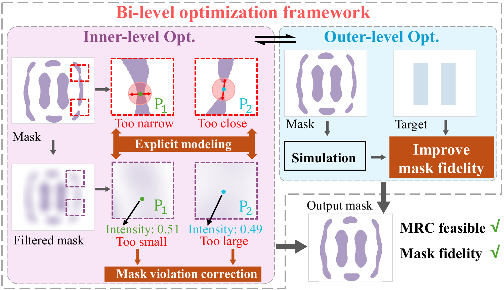
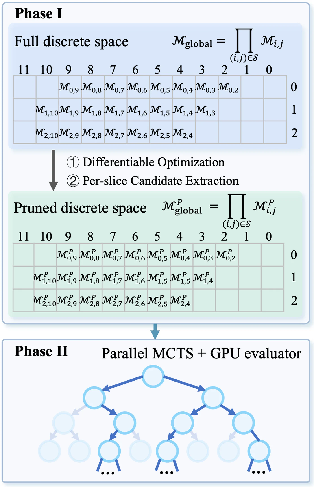
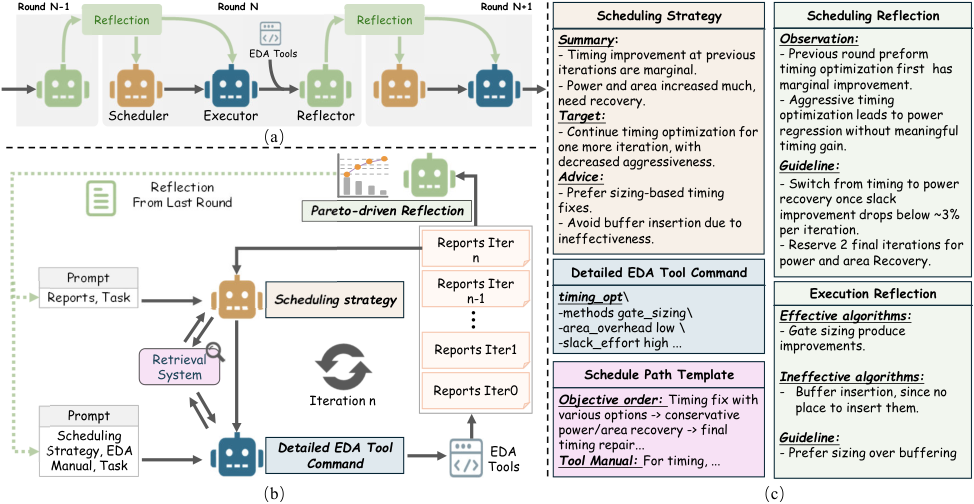
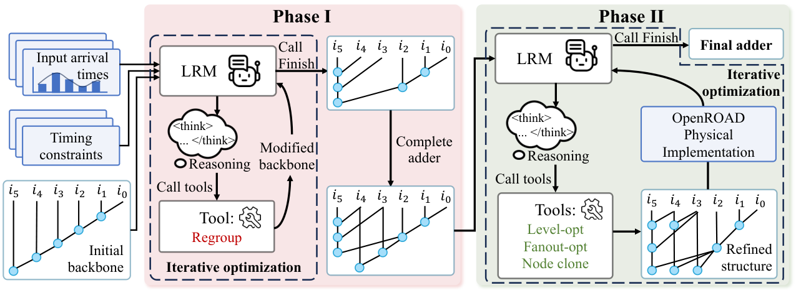
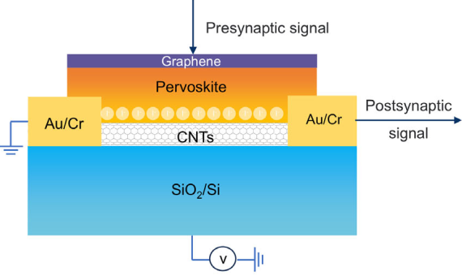
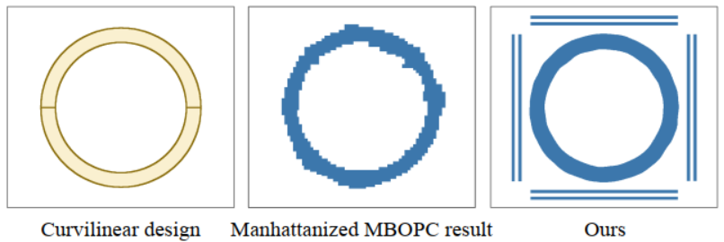
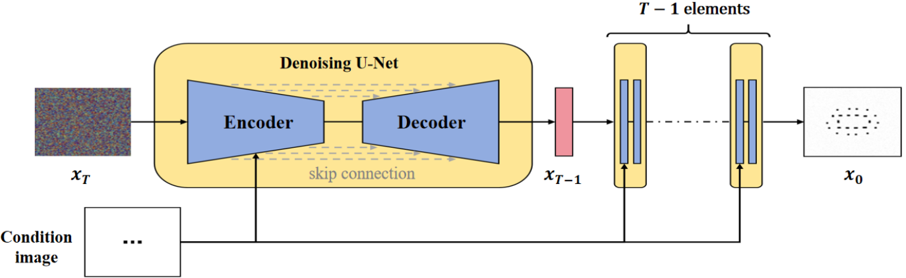
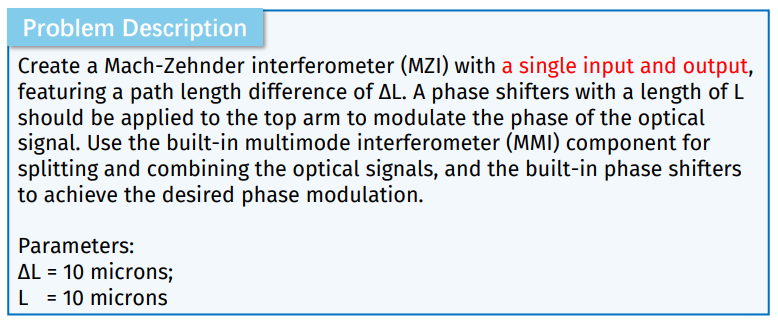








Yang LUO is a Ph.D. candidate in Microelectronics at the Hong Kong University of Science and Technology (Guangzhou), supervised by [Prof. Yuzhe Ma](https://www.yuzhe-ma.com/) and [Prof. Yeyu Tong](https://personal.hkust-gz.edu.cn/yeyutong/). His current research focuses on **agentic photonic design**, using AI agents to design and verify photonic devices and integrated circuits through interactions with simulation and design tools. His broader interests include machine learning for electronic design automation and inverse lithography.

He received his B.E. degree in Intelligence Science and Technology from the University of Science and Technology Beijing, China. He also holds an M.S. degree from the School of Computer Science and Technology, University of Chinese Academy of Sciences, Beijing, China.

If you're interested in my research, feel free to reach out! I look forward to discussing and collaborating with you!

# 🛠 Research

- **Harness** — Build environments where agents can turn design specifications into candidate photonic devices and circuits, run simulations and design-rule checks, and revise their designs using tool feedback.
- **Benchmark** — Define reproducible photonic design tasks that measure whether agents meet optical performance targets and satisfy design constraints. [PICBench](https://github.com/PICDA/PICBench) is an earlier project that evaluates LLM-generated photonic circuit netlists through simulation.
- **Dataset** — Curate design specifications, reference netlists and layouts, simulation results, and records of design iterations to support agent training and evaluation.

# 🔥 News
- *2026*: &nbsp;🎉🎉 **BILT** was accepted by **IEEE TCAD**.
- *2026.11*: &nbsp;🎉🎉 **TAP-MAC** appeared in the [**ICCAD 2026** technical program](https://iccad.com/2026/full-program).
- *2026.09*: &nbsp;🎉🎉 **PrefixAgent** was published online in [**ACM TODAES**](https://doi.org/10.1145/3843236).
- *2026.09*: &nbsp;🎉🎉 **Retrieve, Schedule, Reflect** appeared in the [**MLCAD 2026** technical program](https://mlcad.org/symposium/2026/program/).
- *2025.08*: &nbsp;🎉🎉 **BEAM** was accepted to **ASP-DAC 2026**! Many thanks to my collaborators!
- *2025.07*: &nbsp;🎉🎉 One paper accepted to **ADVANCED MATERIALS (AM)**! Many thanks to my collaborators!
- *2025.04*: &nbsp;🎉🎉 One paper accepted to **ISEDA 2025**! Many thanks to my collaborators!
- *2025.02*: &nbsp;🎉🎉 One paper accepted to **DATE 2025**! Many thanks to my collaborators!
- *2024.06*: &nbsp;🎉🎉 Excited to announce that my first paper as a Ph.D. student has been accepted to [**ICCAD 2024**](https://2024.iccad.com/)! Many thanks to my advisor and colleagues for their support!
- *2023.09*: &nbsp;🎉🎉 I'm excited to have joined HKUST (GZ)! Looking forward to my research journey ahead and outcomes!
# 📝 Publications 

<i>“What I cannot create, I do not understand.”</i> — Richard Feynman

IEEE TCAD

**BILT: Bi-level Optimization for Inverse Lithography with Mask Rule Modeling**

*IEEE Transactions on Computer-Aided Design of Integrated Circuits and Systems (TCAD), accepted*

**Yang Luo**, Xiaonan Huang, Xiaoxiao Liang, Hao Chen, Haopeng Yan, Haoyu Yang, Yeyu Tong, Yuzhe Ma

[DOI](https://doi.org/10.1109/TCAD.2026.3748335)

- **Contribution**: Theoretical analysis and algorithm design, experiment implementation, and paper writing

ICCAD 2026

**TAP-MAC: Low-Power Optimization of Multipliers and Multiply-Accumulators via Topology-Aware Power Modeling**

*IEEE/ACM International Conference on Computer-Aided Design (ICCAD 2026)*

Dongsheng Zuo, **Yang Luo**, Jiadong Zhu, Yuzhe Ma

[Conference program](https://iccad.com/2026/full-program)

- **Contribution**: Algorithm design discussion

MLCAD 2026

**Retrieve, Schedule, Reflect: LLM Agents for Chip QoR Optimization**

*ACM/IEEE International Symposium on Machine Learning for CAD (MLCAD 2026)*

Yikang Ouyang, **Yang Luo**, Dongsheng Zuo, Yuzhe Ma

[arXiv](https://arxiv.org/abs/2603.13767), [Code](https://github.com/YiKangOY/LLM-PO)

- **Contribution**: Algorithm design discussion, paper writing

TODAES 2026

**PrefixAgent: An LLM-Powered Design Framework for Efficient Prefix Adder Optimization**

*ACM Transactions on Design Automation of Electronic Systems (TODAES), 2026*

Dongsheng Zuo, Jiadong Zhu, **Yang Luo**, Yuzhe Ma

[DOI](https://doi.org/10.1145/3843236), [arXiv](https://arxiv.org/abs/2507.06127)

- **Contribution**: Algorithm design discussion

ADVANCED MATERIALS

 A Novel Time-Division Multiplexing Architecture Revealed by Reconfigurable Synapse for Deep Neural Networks 

<i>In ADVANCED MATERIALS (AM)<i>

Yutao Li, Kui Xu, Yuzhe Ma, Junze Li, **Yang Luo**, Xinru Li, Penghui Shen, Luyu Zhao, Hang Liu, Li Ren, Dehui Li, Lianmao Peng, Li Ding, Tianling Ren, Yeliang Wang

[Paper](https://advanced.onlinelibrary.wiley.com/doi/full/10.1002/adma.202420218)

- **Contribution**: Algorithm design, experiment implementation and paper writing

ASP-DAC 2026

 BEAM: Bidirectional MEEF-Driven Mask Optimization for Curvilinear Photonic Design 

<i>IEEE/ACM Asian and South Pacific Design Automation Conference (ASP-DAC ’26)<i>

Xiaoxiao Liang, **Yang Luo**, Bei Yu, Yuzhe Ma

[Paper](https://doi.org/10.1109/ASP-DAC66049.2026.11420526)

- **Contribution**: Experiment implementation

ISEDA 2025

 Efficient SRAF Generation via Diffusion Models 

<i>In International Symposium of Electronics Design Automation (ISEDA ’25)<i>

Minjie Bi, **Yang Luo**, Xiaoxiao Liang, Zhengzhou Gu, Jinbin Deng, Binwu Zhu, Yuzhe Ma

[Paper](../manus/C53-ISEDA2025-DiffSRAF.pdf)

- **Contribution**: Paper writing

DATE 2025

 PICBench: Benchmarking LLMs for Photonic Integrated Circuits Design 

<i>In IEEE/ACM Design, Automation, and Test in Europe (DATE ’25)<i>

Yuchao Wu, Xiaofei Yu, Hao Chen, **Yang Luo**, Yeyu Tong, Yuzhe Ma

[Paper](https://doi.org/10.23919/DATE64628.2025.10992854), [arXiv](https://arxiv.org/abs/2502.03159), [Code and benchmark](https://github.com/PICDA/PICBench)

- **Contribution**: Paper writing

ICCAD 2024

 Enabling Robust Inverse Lithography with Rigorous Multi-Objective Optimization 

<i>In IEEE/ACM  International Conference on Computer-Aided Design (ICCAD ’24)<i>

**Yang Luo**, Xiaoxiao Liang, Yuzhe Ma

[Paper](../manus/C38-ICCAD2024-PV-ILT.pdf), [Slides](../slides/ICCAD24-slides.pdf)

- **Contribution**: Theoretical analysis and algorithm design, experiment implementation, and paper writing

IJCAS 2020

 [Fixed-time synchronization of complex-valued memristive BAM neural network and applications in image encryption and decryption](https://link.springer.com/article/10.1007/s12555-018-0676-7) 

<i>International Journal of Control, Automation and Systems (IJCAS ’20)<i><strong></strong>

YongZhen Guo, **Yang Luo**, WangWei Ping, et al.

- **Contribution**: Theoretical analysis and algorithm design, experiment implementation, and paper writing

# 🎖 Honors and Awards
- *2020* Tianchi competition of MEDIA-AI Alibaba Algorithm Challenge - HD Video Segmentation (6/733)
- *2019* Excellent graduates of Beijing University of Science and Technology
- *2018* National Third Prize of Siemens Intelligent Manufacturing Competition
- *2018* National Third Prize in the 8th "Huawei Cup" National Undergraduate Intelligent Design Competition
- *2016~2018* People's Scholarship, Outstanding student

# 📖 Educations

M.S. degree from [School of Computer Science and Technology](https://scce.ucas.ac.cn/), University of Chinese Academy of Sciences, Beijing, China

2019.09 - 2023.01

B.E. degree from [Intelligence Science and Technology](https://ai.ustb.edu.cn/), the University of Science and Technology Beijing, China

2015.09 - 2019.06

# 💻 Internships
- *2021.08 - 2022.06*, SmartMore, Shenzhen. Working with Xufeng Yao and [Prof.Bei Yu](https://www.cse.cuhk.edu.hk/~byu/) on OCR and model compressing.
- *2021.04 - 2021.07*, Samsung Advanced Institute of Technology & Peking University ZERO Lab, Beijing. Working with Bin Dai on group-equivalent network for object detection
